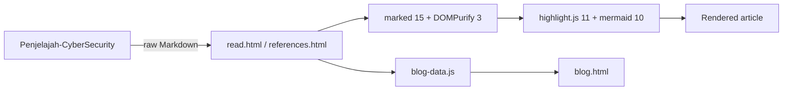

# imoon07.github.io

Personal website and portfolio of **Raja Muhammad Kurnia Setyawan (@iMoon07)** — security,
penetration testing, and technical writing.

- **Live site:** <https://imoon07.github.io/>
- **Content (Markdown articles and references):** <https://github.com/iMoon07/Penjelajah-CyberSecurity>
- **Logo assets:** <https://github.com/iMoon07/logo-svg>
- **Tooling (generators and probes):** <https://github.com/iMoon07/ai-tools>

Static HTML, CSS, and JavaScript. No build step, no framework, no bundler: pages load
`css/` and `js/` directly. Article and reference Markdown is fetched at runtime from the
content repository, so the site repo holds presentation only.

## Pages

| Page | What it does |
| --- | --- |
| `index.html` | Home and About in one document, switched in place. About has tabbed panels (Profile, Experience, Community, License) and the logo digital-rain background. |
| `blog.html` | Post listing: 25 posts, 8 categories, search, filter, pagination. |
| `read.html` | Article reader: TOC (desktop/mobile/inline), code copy, lightbox, video, giscus comments, reading progress, math, footnotes, mermaid. |
| `references.html` | Docs hub: 83 reference modules in 7 groups, filter, command search (`Ctrl+K`), language variants (`?lang=`, en/id fallback), mobile drawers. |
| `draw.html` | Alur playground: infinite canvas, sticky notes, tables, Rough.js strokes, laser pointer, 29 chart types. |
| `topology.html` | Authoring page for ` ```topology ` blocks: live preview, presets, `Copy ```topology`. |
| `about.html`, `alur.html`, `preview.html` | Redirect stubs (about → `index.html#about`, the other two → `draw.html`). |
| `robots.txt`, `sitemap.xml`, `BingSiteAuth.xml`, `google1a45e…html` | Search-engine verification and indexing. |

## Content flow



## Libraries

| Library | Version | Loaded by | Purpose |
| --- | --- | --- | --- |
| marked | 15.0.12 (jsDelivr) | `read.html`, `references.html` | Markdown → HTML, GFM |
| DOMPurify | 3.2.4 (jsDelivr) | `read.html`, `references.html` | Sanitize before insertion |
| highlight.js | 11.11.1 (jsDelivr, lazy) | `read.js` | Code highlighting |
| mermaid | 10.9.1 (jsDelivr, lazy) | `read.js` | ` ```mermaid ` blocks |
| Rough.js | vendored, MIT (CDN fallback `roughjs@latest`) | `draw.html`, `read.html` | Hand-drawn strokes for Alur |

`vendor/rough.js` is the only vendored library; it falls back to the unpkg CDN if the local
file is missing. Everything else comes from a CDN at runtime.

## Diagrams

Two renderers, deliberately separate:

- **` ```topology `** — static, flow-driven diagrams that the renderer lays out for you.
  `js/topology.js` + `css/topology.css`, icons from the generated `js/topology-icons.js`.
  Authoring guide: [`docs/topology-guide.md`](docs/topology-guide.md).
- **` ```draw `** (Alur) — free-form canvas with a grid, cables, motion effects, and chart
  modules. `js/alur/` + `css/alur.css`. Authoring guide:
  [`docs/alur-guide.md`](docs/alur-guide.md).

A page can group several examples behind buttons with ` ```draw-tabs `.

Alur in numbers: 6 modules (canvas, flow, reverse-proxy, chart, pipeline, graph), 14 cable
styles, 13 motion effects, 29 chart types, Rough.js outlines on every node, sticky notes,
editable tables, node links, bucket fill, lasso, and a laser pointer.

## Development

No build step. Serve the folder:

```bash
python3 -m http.server 8000
# http://localhost:8000
```

Articles are fetched from raw GitHub URLs, so remote Markdown needs a network connection.

### Add a post

1. Add the Markdown to the content repo (`your-post-id.md` / `your-post-en.md`).
2. Register it in `js/blog-data.js` under `myProjects`:

```js
{
  id: "unique-post-slug",
  title: "Post Title",
  category: "web-security",
  tags: ["tag-a", "tag-b"],
  publishedDate: "YYYY-MM-DD",
  publishedTime: "HH:mm",
  rawUrl: "https://raw.githubusercontent.com/iMoon07/Penjelajah-CyberSecurity/main/path/to/post-id.md",
  repoUrl: "https://github.com/iMoon07/Penjelajah-CyberSecurity/tree/main/path/to/folder"
}
```

3. Commit and push; GitHub Pages serves the update.

### Add a reference module

Add the Markdown under `References/` in the content repo, then register it in
`js/docs-references-data.js` inside `REFERENCE_MODULES` (`id`, `title`, `group`, `src`).

### Regenerate the icon sprite and logo manifest

Both generators live in the `ai-tools` repo, cloned next to the site:

```bash
python3 ../ai-tools/generators/build_topology_icons.py     # js/topology-icons.js
python3 ../ai-tools/generators/build_logo_manifest.py --site .
```

`js/topology-icons.js` and `js/logo-manifest.js` are generated — do not edit them by hand.

## Repository layout

```text
index.html blog.html read.html references.html
draw.html topology.html about.html alur.html preview.html
css/     shell home style article docs topology alur topo
js/      home blog-data main read markdown references
         docs-references-data topology topology-icons logo-manifest
js/alur/ core kit cables motions logos draw-tabs modules/
vendor/  rough.js
docs/    topology-guide.md alur-guide.md
assets/  portrait, logos, recognition PDFs
```

`css/topo.css` and `js/topo.js` / `js/topo-lang.js` are unused leftovers from an earlier
renderer; `js/topology.js` is the one in use.

## License

See [LICENSE](LICENSE).