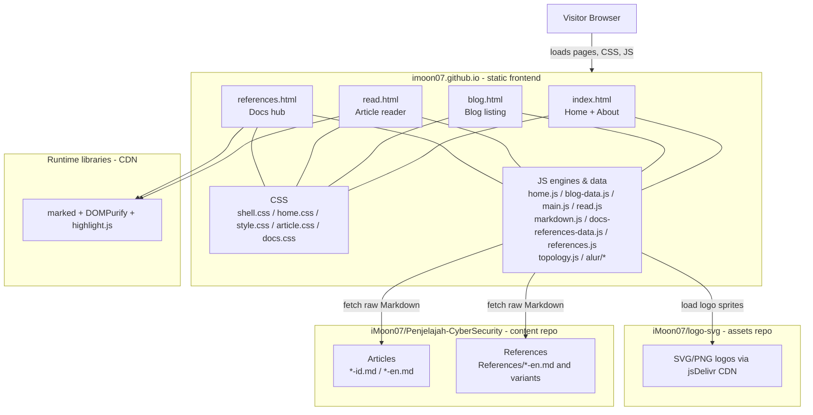
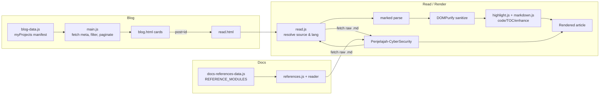

# imoon07.github.io

Personal website and portfolio of **Raja Muhammad Kurnia Setyawan (@iMoon07)** — security, penetration testing, and technical writing.

**Built portofolio to success.**

- **Live site:** [imoon07.github.io](https://imoon07.github.io/)
- **Content repository (Markdown articles & references):** [iMoon07/Penjelajah-CyberSecurity](https://github.com/iMoon07/Penjelajah-CyberSecurity)
- **Logo assets (digital rain background):** [iMoon07/logo-svg](https://github.com/iMoon07/logo-svg)
- **Template/test post (local):** [EN](file:///home/moon/Projects/imoon07.github.io/read.html?post=blog-post-template&lang=en) · [ID](file:///home/moon/Projects/imoon07.github.io/read.html?post=blog-post-template&lang=id) · [MS](file:///home/moon/Projects/imoon07.github.io/read.html?post=blog-post-template&lang=ms) · [TL](file:///home/moon/Projects/imoon07.github.io/read.html?post=blog-post-template&lang=tl)

---

## Overview

This is a **static site** (plain HTML, CSS, and JavaScript) with **no build step and no framework**.  
Page structure, styles, and UI logic live in this repository. **Article and reference content lives in a separate repository** and is fetched at runtime as raw Markdown from GitHub.

## System topology



## Page systems

### Home & About (`index.html` + `js/home.js` + `css/home.css`)

- Home and About share a **single document** with in-page navigation (no full reload).
- **About** contains tabbed panels: Profile, Experience, Community, License, with slide/gesture controls and panel state managed in `home.js`.
- Portrait/contact/social block adapts between desktop and mobile layouts.
- **Digital rain logo effect:** `home.js` renders a curated set of logos loaded from `https://cdn.jsdelivr.net/gh/iMoon07/logo-svg@main/` (sourced from the `iMoon07/logo-svg` repository) behind/about the About visuals.

### Blog listing (`blog.html` + `js/blog-data.js` + `js/main.js`)

- `js/blog-data.js` defines the manifest `myProjects` (each entry: `id`, `title`, `category`, `tags`, `publishedDate`, `publishedTime`, `rawUrl`, `repoUrl`, etc.).
- `js/main.js` reads the manifest, fetches article metadata/preview from each entry’s `rawUrl`, then handles search, filtering, pagination, and card rendering.
- Selecting a post navigates to the reader: `read.html?post=<id>`.

### Article reader (`read.html` + `js/read.js` + `js/markdown.js`)

- Resolves the target article from `post` (and supports doc/ref/lang parameters where applicable).
- Chooses the Markdown source (and language variant, e.g. `-id.md` / `-en.md`) from manifest/raw URLs.
- Fetches raw Markdown at runtime from the content repository, parses and sanitizes it, then enhances the reading experience (headings/TOC, code blocks, navigation/related UI, and other reader interactions).

### Docs / References (`references.html` + `js/docs-references-data.js` + `js/references.js`)

- `js/docs-references-data.js` defines `REFERENCE_MODULES` (`id`, `title`, `group`, `src` pointing to raw `*-en.md` files under `References/` in `Penjelajah-CyberSecurity`, with language-variant resolution).
- `references.js` powers the docs hub (materials navigation, filtering/search, layout behavior) and loads content through the reader/render pipeline.

## Content & rendering flow



## Markdown stack (reader requirements)

Used by `read.html` and `references.html` to render remote Markdown safely and readably:

| Library / file | Version / source | Purpose |
|---|---|---|
| **marked** | `15.0.12` (jsDelivr CDN) | Parse Markdown to HTML (GFM options enabled in reader) |
| **DOMPurify** | `3.2.4` (jsDelivr CDN) | Sanitize parsed HTML before insertion (XSS-safe rendering) |
| **highlight.js** | `11.11.1` (cdn-release via jsDelivr, loaded on demand) | Syntax highlighting for code blocks |
| **mermaid** | `10.9.1` (jsDelivr CDN, loaded on demand) | Render ```mermaid blocks to SVG with an interactive viewer (zoom/pan/fit, source/copy, fullscreen), responsive on mobile and desktop |
| **js/markdown.js** | local | Project markdown extensions/helpers used by the reader pipeline |

> The reader fetches `.md` content over the network at runtime; Markdown rendering depends on the libraries above being available.

## Typography & theme

- **UI/body font stack:** `Inter, "Segoe UI", system-ui, -apple-system, "Helvetica Neue", Arial, "Noto Naskh Arabic", "Amiri", sans-serif` (consistent across Home/About, Blog, Read, Docs).
- **Arabic fallback:** `Amiri` and `Noto Naskh Arabic` (imported in `css/shell.css`) for correct Arabic/greeting glyphs.
- **Monospace (code):** `ui-monospace, SFMono-Regular, "SF Mono", Menlo, Consolas, "Liberation Mono", monospace`.
- **Theme tokens (`css/shell.css`):** dark canvas tuned for reading comfort (e.g. `--bg: #111827`, `--text: #e6edf3`, `--muted: #8b949e`, accent/lines aligned across pages).

## How to use

### Local preview

No build step. Serve the folder or open `index.html`:

```bash
git clone https://github.com/iMoon07/imoon07.github.io.git
cd imoon07.github.io
python3 -m http.server 8000
# open http://localhost:8000
```

> Note: Blog/Docs/Read content is fetched from raw GitHub URLs in the content repository, so an internet connection is required for remote Markdown to load.

### Add or upload a blog post

1. **Create the Markdown in the content repo:** add and push the article file (follow language naming such as `your-post-id.md` / `your-post-en.md`) to [iMoon07/Penjelajah-CyberSecurity](https://github.com/iMoon07/Penjelajah-CyberSecurity).
2. **Register it in this site:** edit `js/blog-data.js` and append an entry to `myProjects`:

```js
{
  id: "unique-post-slug",
  title: "Post Title",
  category: "web-security",
  tags: ["tag-a", "tag-b"],
  publishedDate: "YYYY-MM-DD",
  publishedTime: "HH:mm",
  rawUrl: "https://raw.githubusercontent.com/iMoon07/Penjelajah-CyberSecurity/main/path/to/post-id.md",
  repoUrl: "https://github.com/iMoon07/Penjelajah-CyberSecurity/tree/main/path/to/folder"
}
```

3. **Publish:** commit and push this repository — GitHub Pages serves the update at [imoon07.github.io](https://imoon07.github.io/).

### Add a Docs/Reference module

1. Add the Markdown file under `References/` in the content repository (e.g. `*-en.md`).
2. Register it in `js/docs-references-data.js` inside `REFERENCE_MODULES` with `id`, `title`, `group`, and `src` (raw GitHub URL).

### Update About content (current)

About content and panels are defined in `index.html` with behavior/styles in `js/home.js` and `css/home.css`.

## Responsive & mobile view

- **Home/About:** desktop uses a two-column layout (portrait and content); on mobile the portrait stays on the left with the greeting/name and contact row aligned to the right, and panels stack below.
- **Blog:** listing, filters/search, and pagination adapt to smaller screens with mobile-friendly navigation and header controls.
- **Read (articles):** single-column reading layout optimized for small screens with responsive typography, media, and TOC/navigation behavior.
- **Docs/References:** responsive docs layout with collapsible navigation/contents patterns for mobile and tablet.
- Shared shell navigation and spacing scale across breakpoints for phones, tablets, and desktop.

## Topology diagrams

Articles can embed diagrams with a fenced ` ```topology ` block (JSON). The renderer
(`js/topology.js` + `css/topology.css`) is static and responsive: it sits at the article
column width, stacks vertically on narrow screens, and draws solid edges with arrowheads
(no dashes). Optional flow dots travel along each edge and `live` nodes pulse; both stop
under `prefers-reduced-motion`. See **[docs/topology-guide.md](docs/topology-guide.md)** for
the full authoring guide, recipes, and verification steps.

```topology
{
  "title": "Alur",
  "vertical": true,
  "columns": [["C"], ["P"]],
  "nodes": {
    "C": ["Pelanggan", "Datang", "customer", "actor", "https://…"],
    "P": ["Pelayan", "Meneruskan", "waiter", "process"]
  },
  "edges": [["C", "P", "1"]],
  "groups": [["Satu Lokasi", ["C", "P"]]]
}
```

- **columns** — left-to-right groups; `[ids]` or `{ "nodes": [ids], "grid": 2 | 3 | 4 }`. A grid lays its nodes row-major and scales down to the article width. `"vertical": true` forces the top-to-bottom layout on every viewport (stacked columns, downward forward edges, return paths drawn as a parallel upward cable beside the forward one) for short linear flows. `"dense": true` compacts the diagram for many narrow columns: small nodes, tight gaps, component logos, and one language row per line on narrow screens.
- **root** — optional parent node above every column, wired to the first node of each column: a bus above on desktop, a left-gutter trunk per row on narrow screens. Takes the same compact node array.
- **caption** — optional visible heading above the canvas; `captionHref` turns it into a link. Use it when the heading is not a wired node; use `root` when it is.
- **components** — optional shared registry `key -> [label, icon, href]` (icon may be a list). Nodes reference keys in `icons` instead of repeating every logo and link; the component label is drawn as a small clickable text line under the logos, so names such as Linux, Apache, MySQL, PHP, Manager, Indexer and Dashboard stay readable and clickable. A label equal to the node title is not repeated.
- **nodes** — compact array `[label, sub, iconOrIcons, kind, href, live]` (trailing items optional) or an object. `icon` is one sprite id: a concept icon (`user-round`, `server`, `database`, `shield`, `store`, `wifi`, `wrench`, `trash-2`, …), a profession icon (`customer`, `waiter`, `chef`, `cook`, `baker`, `courier`, `mechanic`, `plumber`, `detective`, …), or a brand logo `si-<slug>` (`si-javascript`, `si-docker`, `si-postgresql`, `si-laravel`, …). `icons` holds several logos for one node — either component keys from `components` (`["linux", "apache", "mysql", "php"]`), bare ids (`["si-linux", "si-apache"]`), `[id, href]` pairs (`[["si-linux", "https://www.kernel.org/"], …]`), or `{icon, href, label}` objects. With per-logo links the card becomes a `div` and the label links to `href`. `kind` sets the accent: actor, process, store, choice, out, tech, host, database, cloud, security, network. `hidden: true` reserves a grid cell without drawing a node. `live: true` pulses the icon; `live: "cook"` stirs it like a cooking pot.
- **edges** — compact `[from, to, badge?, back?]` or an object. `back: true` draws a return path (solid green with an arrowhead). On a horizontal layout it routes orthogonally below all nodes; on a vertical layout a return between neighbouring nodes climbs as a parallel cable beside the forward one (source top edge to target bottom edge), and only a blocked return falls back to a shared right-hand gutter. A small dot travels along every drawn connection (forward, return, bus trunk, header, drop) to show direction (blue forward, green back, fading at both ends); the dot speed is a fixed value per path, not per edge length. Two or more edges from one source (or into one target) are routed as a bus: one vertical trunk in the column gap and one arrowed stub per node. Multi-column grids get one trunk per column, fed by a header above the grid, so no line crosses a node. A top-level `"badges": false` hides every edge number; by default a `badge` on an edge draws a small outlined number at the middle of the line.
- **groups** — compact `[label, [ids], icon?]` or an object; renders a caption above the set (no box).
- **legend** — `{ "flow": "…", "back": "…" }`; renders a direction key under the diagram.
- **facilities** — `[label, [icon, label], …]`; renders place/tool chips under the diagram.

### Icon library

`js/topology-icons.js` is generated — do not edit by hand. It inlines three families:

- **concept icons** — Lucide stroke icons (currentColor). Hand-written symbols survive rebuilds; drop a new `ai-tools/tools/icons/<name>.svg` (Lucide format) and rerun to add one.
- **profession icons** — real role marks for people/agents (`customer`, `waiter`, `chef`, `cook`, `baker`, `cashier`, `courier`, `mechanic`, `plumber`, `detective`, `hacker`, `teacher`, `doctor`, …), from the same Lucide pipeline.
- **brand icons** — Simple Icons / devicon logos discovered automatically from `programming/` and `stack/` in the local logo repo, emitted as `i-si-<slug>`. A small allowlist (`BRAND_EXTRA`) also pulls selected logos from the large `security/` folder (currently `wazuh`). Drop a new SVG in the repo and rerun; no script edit needed. Brand colours are preserved; single-colour logos too dark for the dark background are lightened, and badge-style logos (JavaScript) keep their dark glyphs. Internal `<defs>` ids are namespaced per symbol.

```bash
python3 ai-tools/tools/build_topology_icons.py     # rebuild the sprite (auto-discovers logos)
# add a logo:    drop the SVG in ../logo/programming or ../logo/stack, rerun
# add a concept: drop ai-tools/tools/icons/<name>.svg, rerun
```

## Roadmap / Next

- **Modular About config:** centralize About data (profile, experience, community, license, links) in a single config/data source for easier edits and reordering.
- **Light & dark mode:** add theme support with a light/dark toggle, persisted user preference, and accessible contrast across all pages.
- **Topology / diagram system:** extend the ` ```topology ` DSL with more node kinds (computer, network, cloud, security) and edge styles; add sequence/stack/network diagram types. For animated explainers, use the Alur engine (` ```draw `) and its cable/motion catalog.
- **Logo library expansion:** grow the Simple Icons set via `ai-tools/tools/build_topology_icons.py`; cover more languages, frameworks, databases, and security tools. Add concept icons by dropping Lucide SVGs in `ai-tools/tools/icons/`.

## Alur visual engine

**Alur** is the site's visual explainer engine: animated cables, motion
effects, and live protocol/algorithm modules. It is a sibling of the topology
renderer, kept separate so architecture diagrams and explainer visuals can grow
without coupling.

- **Engine source:** `js/alur/` — `core.js` (registry/mount), `kit.js` (SVG
  helpers/palette/logo `<image>`), `logos.js` (logo catalogue), `cables.js`
  (14 cable styles), `motions.js` (13 motion effects), `modules/` (canvas,
  flow, reverse-proxy, chart, pipeline, graph).
  `canvas` is a free-form editor (grid, box/pill/circle/plain shapes, freehand
  drawings); `chart` renders 29 chart types; `pipeline` shows ordered stages;
  `graph` animates a BFS frontier.
- **Logos:** remote from [`iMoon07/logo-svg`](https://github.com/iMoon07/logo-svg) via
  `raw.githubusercontent.com`; the site only ships the generated
  `js/logo-manifest.js` (no local logo files). Logo images need access to
  `raw.githubusercontent.com`. Local test override:
  `draw.html?localLogos=1` after copying/symlinking
  `ai-tools/assets/logos/` to `imoon07.github.io/assets/logos/`.
- **Styles:** `css/alur.css`.
- **Playground:** `draw.html` — full-viewport infinite canvas
  (space/middle-drag pan, wheel pan, Ctrl+wheel zoom, minimap), floating
  Properties/Assets/Layers/Scene panels, command palette (`Ctrl+K`), context
  menu, focus mode, multi-select/marquee/alignment/snapping, copy/paste/
  duplicate, undo/redo, Scene templates (including all 29 chart examples),
  cable/motion/speed, and the 587-logo library. Every change renders instantly;
  responsive down to phones.
- **Docs:** `docs/alur-guide.md` — full authoring guide, cable/motion catalog,
  and how to add a module, cable, or motion.

A Markdown article embeds a visual with a fenced ` ```draw ` block (JSON):

```draw
{
  "module": "flow",
  "title": "Request path",
  "cable": "neon",
  "motion": "comet",
  "columns": [["client"], ["proxy"], ["db"]],
  "nodes": {
    "client": { "label": "Client", "color": "blue" },
    "proxy":  { "label": "Proxy",  "color": "cyan" },
    "db":     { "label": "DB",     "color": "purple" }
  },
  "edges": [{ "from": "client", "to": "proxy" }, { "from": "proxy", "to": "db" }]
}
```

A page can group several examples behind buttons with ` ```draw-tabs `:

```draw-tabs
[
  { "label": "Bar", "spec": { "module": "chart", "type": "bar", "labels": ["A", "B"], "data": [3, 5] } },
  { "label": "Donut", "spec": { "module": "chart", "type": "donut", "labels": ["A", "B"], "data": [3, 5] } }
]
```

The `blog-post-template` folder stays Markdown-only; engine JavaScript never
lives there.

## Repository structure (key files)

- `index.html` — Home & About; `about.html` — About page context; `blog.html` — listing; `read.html` — reader; `references.html` — docs hub
- `css/` — `shell.css`, `home.css`, `style.css`, `article.css`, `docs.css`, `topology.css`, `alur.css`
- `js/` — `home.js`, `blog-data.js`, `main.js`, `read.js`, `markdown.js`, `docs-references-data.js`, `references.js`, `topology.js`, `topology-icons.js`
- `js/alur/` — visual explainer engine (`core.js`, `kit.js`, `cables.js`, `motions.js`, `draw-tabs.js`, `modules/*.js`)
- `../ai-tools/tools/` — local-only generators (topology icon sprite, logo manifest)
- `../ai-tools/tools/icons/` — extra Lucide concept icons for the sprite builder
- `docs/topology-guide.md` — full guide for authoring ` ```topology ` diagrams
- `docs/alur-guide.md` — full guide for the Alur visual engine (cables, motions, modules, `draw-tabs` gallery)
- `draw.html` — Draw playground (infinite canvas editor, floating panels,
  command palette, logo library)
- `assets/` — images and static assets
- `robots.txt`, `sitemap.xml` — indexing/SEO helpers

## License

See [LICENSE](LICENSE).

---

**Built portofolio to success.**
