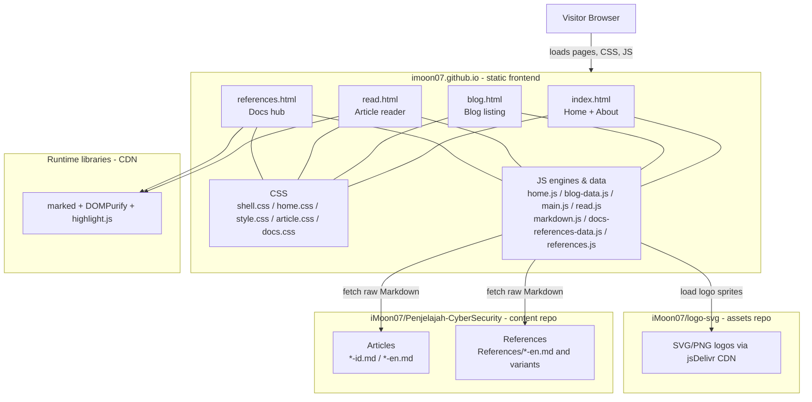
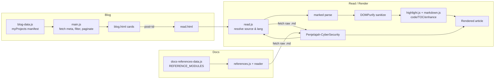

# imoon07.github.io

Personal website and portfolio of **Raja Muhammad Kurnia Setyawan (@iMoon07)** — security, penetration testing, and technical writing.

**Built portofolio to success.**

- **Live site:** [imoon07.github.io](https://imoon07.github.io/)
- **Content repository (Markdown articles & references):** [iMoon07/Penjelajah-CyberSecurity](https://github.com/iMoon07/Penjelajah-CyberSecurity)
- **Logo assets (digital rain background):** [iMoon07/logo-svg](https://github.com/iMoon07/logo-svg)

---

## Overview

This is a **static site** (plain HTML, CSS, and JavaScript) with **no build step and no framework**.  
Page structure, styles, and UI logic live in this repository. **Article and reference content lives in a separate repository** and is fetched at runtime as raw Markdown from GitHub.

## System topology



## Page systems

### Home & About (`index.html` + `js/home.js` + `css/home.css`)

- Home and About share a **single document** with in-page navigation (no full reload).
- **About** contains tabbed panels: Profile, Experience, Community, License, with slide/gesture controls and panel state managed in `home.js`.
- Portrait/contact/social block adapts between desktop and mobile layouts.
- **Digital rain logo effect:** `home.js` renders a curated set of logos loaded from `https://cdn.jsdelivr.net/gh/iMoon07/logo-svg@main/` (sourced from the `iMoon07/logo-svg` repository) behind/about the About visuals.

### Blog listing (`blog.html` + `js/blog-data.js` + `js/main.js`)

- `js/blog-data.js` defines the manifest `myProjects` (each entry: `id`, `title`, `category`, `tags`, `publishedDate`, `publishedTime`, `rawUrl`, `repoUrl`, etc.).
- `js/main.js` reads the manifest, fetches article metadata/preview from each entry’s `rawUrl`, then handles search, filtering, pagination, and card rendering.
- Selecting a post navigates to the reader: `read.html?post=<id>`.

### Article reader (`read.html` + `js/read.js` + `js/markdown.js`)

- Resolves the target article from `post` (and supports doc/ref/lang parameters where applicable).
- Chooses the Markdown source (and language variant, e.g. `-id.md` / `-en.md`) from manifest/raw URLs.
- Fetches raw Markdown at runtime from the content repository, parses and sanitizes it, then enhances the reading experience (headings/TOC, code blocks, navigation/related UI, and other reader interactions).

### Docs / References (`references.html` + `js/docs-references-data.js` + `js/references.js`)

- `js/docs-references-data.js` defines `REFERENCE_MODULES` (`id`, `title`, `group`, `src` pointing to raw `*-en.md` files under `References/` in `Penjelajah-CyberSecurity`, with language-variant resolution).
- `references.js` powers the docs hub (materials navigation, filtering/search, layout behavior) and loads content through the reader/render pipeline.

## Content & rendering flow



## Markdown stack (reader requirements)

Used by `read.html` and `references.html` to render remote Markdown safely and readably:

| Library / file | Version / source | Purpose |
|---|---|---|
| **marked** | `15.0.12` (jsDelivr CDN) | Parse Markdown to HTML (GFM options enabled in reader) |
| **DOMPurify** | `3.2.4` (jsDelivr CDN) | Sanitize parsed HTML before insertion (XSS-safe rendering) |
| **highlight.js** | `11.11.1` (cdn-release via jsDelivr, loaded on demand) | Syntax highlighting for code blocks |
| **js/markdown.js** | local | Project markdown extensions/helpers used by the reader pipeline |

> The reader fetches `.md` content over the network at runtime; Markdown rendering depends on the libraries above being available.

## Typography & theme

- **UI/body font stack:** `Inter, "Segoe UI", system-ui, -apple-system, "Helvetica Neue", Arial, "Noto Naskh Arabic", "Amiri", sans-serif` (consistent across Home/About, Blog, Read, Docs).
- **Arabic fallback:** `Amiri` and `Noto Naskh Arabic` (imported in `css/shell.css`) for correct Arabic/greeting glyphs.
- **Monospace (code):** `ui-monospace, SFMono-Regular, "SF Mono", Menlo, Consolas, "Liberation Mono", monospace`.
- **Theme tokens (`css/shell.css`):** dark canvas tuned for reading comfort (e.g. `--bg: #0d1117`, `--text: #e6edf3`, `--muted: #8b949e`, accent/lines aligned across pages).

## How to use

### Local preview

No build step. Serve the folder or open `index.html`:

```bash
git clone https://github.com/iMoon07/imoon07.github.io.git
cd imoon07.github.io
python3 -m http.server 8000
# open http://localhost:8000
```

> Note: Blog/Docs/Read content is fetched from raw GitHub URLs in the content repository, so an internet connection is required for remote Markdown to load.

### Add or upload a blog post

1. **Create the Markdown in the content repo:** add and push the article file (follow language naming such as `your-post-id.md` / `your-post-en.md`) to [iMoon07/Penjelajah-CyberSecurity](https://github.com/iMoon07/Penjelajah-CyberSecurity).
2. **Register it in this site:** edit `js/blog-data.js` and append an entry to `myProjects`:

```js
{
  id: "unique-post-slug",
  title: "Post Title",
  category: "web-security",
  tags: ["tag-a", "tag-b"],
  publishedDate: "YYYY-MM-DD",
  publishedTime: "HH:mm",
  rawUrl: "https://raw.githubusercontent.com/iMoon07/Penjelajah-CyberSecurity/main/path/to/post-id.md",
  repoUrl: "https://github.com/iMoon07/Penjelajah-CyberSecurity/tree/main/path/to/folder"
}
```

3. **Publish:** commit and push this repository — GitHub Pages serves the update at [imoon07.github.io](https://imoon07.github.io/).

### Add a Docs/Reference module

1. Add the Markdown file under `References/` in the content repository (e.g. `*-en.md`).
2. Register it in `js/docs-references-data.js` inside `REFERENCE_MODULES` with `id`, `title`, `group`, and `src` (raw GitHub URL).

### Update About content (current)

About content and panels are defined in `index.html` with behavior/styles in `js/home.js` and `css/home.css`.

## Responsive & mobile view

- **Home/About:** desktop uses a two-column layout (portrait and content); on mobile the portrait stays on the left with the greeting/name and contact row aligned to the right, and panels stack below.
- **Blog:** listing, filters/search, and pagination adapt to smaller screens with mobile-friendly navigation and header controls.
- **Read (articles):** single-column reading layout optimized for small screens with responsive typography, media, and TOC/navigation behavior.
- **Docs/References:** responsive docs layout with collapsible navigation/contents patterns for mobile and tablet.
- Shared shell navigation and spacing scale across breakpoints for phones, tablets, and desktop.

## Roadmap / Next

- **Modular About config:** centralize About data (profile, experience, community, license, links) in a single config/data source for easier edits and reordering.
- **Light & dark mode:** add theme support with a light/dark toggle, persisted user preference, and accessible contrast across all pages.

## Repository structure (key files)

- `index.html` — Home & About; `about.html` — About page context; `blog.html` — listing; `read.html` — reader; `references.html` — docs hub
- `css/` — `shell.css`, `home.css`, `style.css`, `article.css`, `docs.css`
- `js/` — `home.js`, `blog-data.js`, `main.js`, `read.js`, `markdown.js`, `docs-references-data.js`, `references.js`
- `assets/` — images and static assets
- `robots.txt`, `sitemap.xml` — indexing/SEO helpers

## License

See [LICENSE](LICENSE).

---

**Built portofolio to success.**
